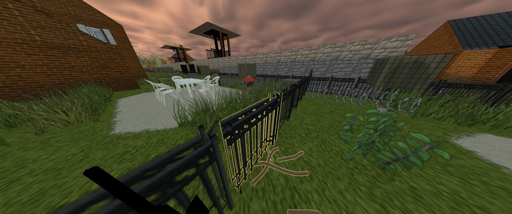
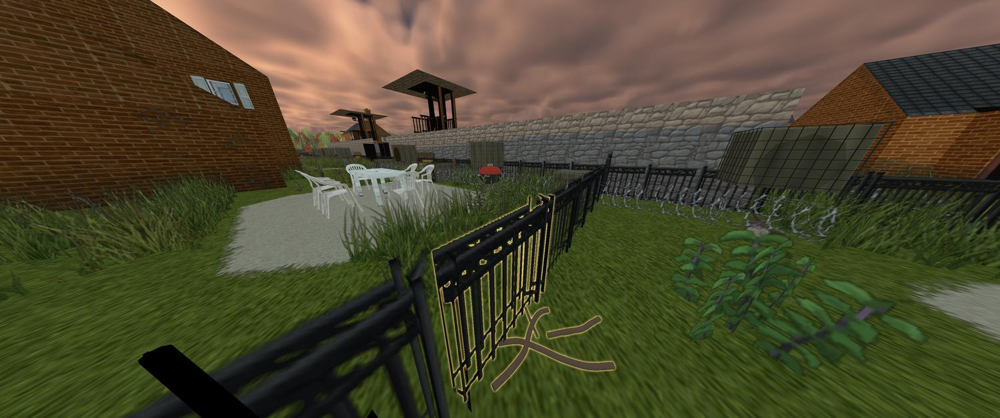
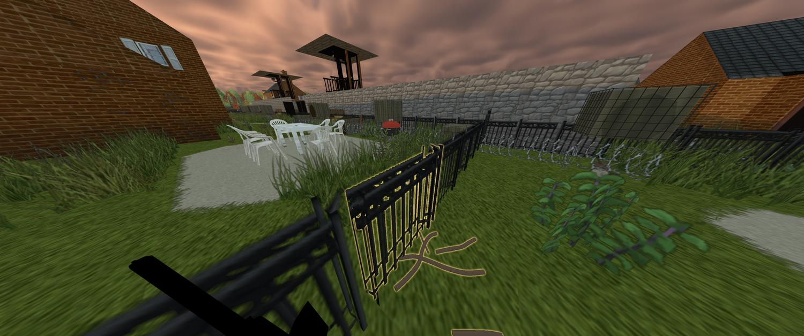
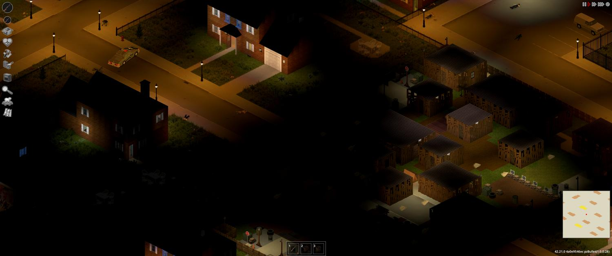
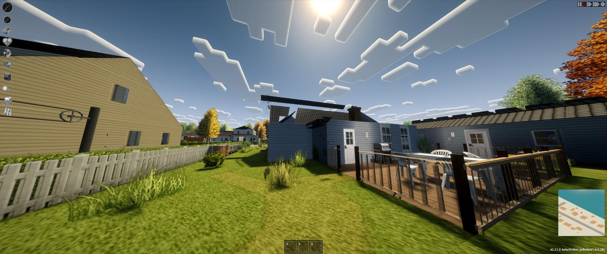

<!-- ░░░░░░░░░░░░░░░░░░░░░░░░░░░░░░░░░░░░░░░░░░░░░░░░░░░░░░░░░░░░░░░░ -->

<div align="center">


<a href="https://readme-typing-svg.demolab.com">
  
</a>

<br/><br/>


<br/>


<br/>


</div>

<br/>

<div align="center">
  
  <br/>
  <sub><i>A settlement raised by the settlers themselves — perimeter wall, twin watchtowers, courtyard and gardens. Shown in the author's game running the 3D <b>Viewpoint</b> mod with shaders; base Project Zomboid is isometric (see the night shot below).</i></sub>
</div>

<br/>

## ✦ The idea

> **Project Zomboid is a world you survive _alone_. [Project A-Life](https://steamcommunity.com/workshop/) fills it with living NPCs. These add-ons let you _belong_ to it.**

Mark out land with four flags and invite the wanderers you meet. From there they do the rest — clear the plot, raise a walled perimeter with working gates, build checkpoints, houses, farms, watchtowers, a garage and a motor pool, recycle junk, level up their skills, and hold the line when raiders come.

There is **no final version**. This is a long-running project that keeps converging toward a moving **reference standard**: the best layout, the smartest behaviour, the most alive world. When the standard improves, existing settlements **auto-rebuild toward it on reload** — tearing down the old and raising the new — so you never have to regenerate anything by hand.

<br/>

## ✦ What's inside

<table>
<tr>
<td width="50%" valign="top">

### 🏰 ALifeCamp
**Settlements that build themselves.**
Flag off any plot, invite A-Life NPCs, and watch a real community grow: storage, a walled perimeter with gates, defended checkpoints, houses, farms, watchtowers, a garage & motor pool. Settlers clear land, recycle, farm, skill up and fight off raids on their own. Grows **camp → city**.

`requires` Project A-Life NPCs

</td>
<td width="50%" valign="top">

### 📻 ALifeRU
**A living, Russian-speaking world.**
Full Russian localization of Project A-Life (speech, radio, UI) plus a pack of **16 world events** — raids, gang wars, bikers, arson, a sheriff response, roadblocks, ambushes, refugees, supply drops, chopper crashes, horde marches, military sweeps.

`requires` Project A-Life NPCs

</td>
</tr>
</table>

<br/>

## ✦ How a settlement builds itself

Every in-game minute the settlement runs one step of a real pipeline:

| Phase | What the settlers do |
|:--|:--|
| 🧹 **Clear** | Fell trees, cut grass, haul junk, remove wrecks & corpses — logs and planks go to storage |
| 📐 **Plan** | Auto-draft and extend a layout: perimeter fence, gates, checkpoints, storage, houses, farms, towers, plaza, streets, lamps, market, wells, gardens, garage, range |
| 🔨 **Build** | Raise it stage-by-stage from real vanilla tiles; speed scales with builders and their skill |
| 📦 **Supply** | Bottomless crates; settlers haul boards, nails, metal, food, water, meds, ammo, seeds |
| ♻️ **Economy** | Saw logs → planks, recycle scrap → cloth/metal, forge nails, harvest crops, scavenge nearby houses |
| 🛡️ **Defend** | Walls, towers, checkpoints, vehicles on posts, armed guards; raids hit the gates |
| 📈 **Grow** | When it's built and peopled, the border pushes outward and the tier climbs |

<br/>

### Settlement tiers


A settlement is promoted only when **population, size _and_ building count** all cross the next threshold (roughly **5 → 12 → 25 → 50** settlers), and it never gets demoted on a bad week.

<br/>

## ✦ Gallery

<table>
<tr>
<td width="50%"><br/><sub>Inner courtyard, twin watchtowers & garden plots</sub></td>
<td width="50%"><br/><sub>Perimeter gate and gardens</sub></td>
</tr>
<tr>
<td width="50%"><br/><sub>The native isometric view at night</sub></td>
<td width="50%"><br/><sub>Fenced lots and tidy paths between buildings</sub></td>
</tr>
</table>

<br/>

## ✦ Languages

ALifeCamp speaks **English, Русский, Українська, Deutsch and Italiano**. It follows the language you pick in the game's own **Options → Language** automatically — that menu is the one chooser for everything. Prefer a different language just for the mod? Open the camp window (**F6 → Settings**) and click the **Language** line to cycle **Auto → English → Русский → Українська → Deutsch → Italiano**; the choice is remembered and overrides only ALifeCamp. Anything a language is missing falls back to English.

> Translations are community-grade and easy to extend — drop a `Translate/<CODE>/UI.json` next to the others. Corrections welcome via issues.

## ✦ Install & load order

Enable in-game, then **restart** — Project Zomboid reads Lua only at launch.

```
1. Project A-Life NPCs
2. ALifeRU
3. ALifeCamp
```

Copy the folders from [`mods/`](mods) into `%UserProfile%\Zomboid\mods`, or run:

```bash
python tools/install.py
```

Open the camp window with **F6**: take the four flags, place them at the corners, create the camp, then right-click a friendly A-Life NPC → **Camp → Invite**.

<details>
<summary><b>More details & docs</b></summary>

- 📖 [ALifeCamp guide](docs/ALifeCamp.md) — every phase, window tabs, gates, vehicles, skills, options
- 📻 [ALifeRU guide](docs/ALifeRU.md) · [full event list](docs/ALifeRU-events.md)
- 🛠️ [Development](docs/DEVELOPMENT.md) — how the code is laid out, the engine-model tests, the sync workflow
- 🤝 [Sharing](docs/SHARING.md) — collaborators, friend archives, Steam Workshop

</details>

<br/>

## ✦ Roadmap

- [x] Self-building settlements with clear → plan → build → defend loop
- [x] Walled perimeter, wide vehicle gates, defended checkpoints, watchtowers
- [x] Tier model (camp → city) with hysteresis
- [x] House adoption, farms & gardens, recycling economy, power grid
- [x] Auto-converge old settlements to the latest design standard on reload
- [ ] Richer combat-ready checkpoints (post-apocalyptic blockpost designs)
- [ ] Compact camp UI with an overall build % and a tiled project grid
- [ ] More believable construction animations & settler attachment
- [ ] Keep closing the gap to the reference standard, update after update

<br/>

## ✦ Credits & permissions

- Built on top of **Project A-Life NPCs** — these are add-ons that require it. All credit for A-Life goes to its author.
- **ALifeRU** includes Russian translations of Project A-Life's in-game strings, used to localize the mod and credited to the original work. If you are the A-Life author and would like a change, please open an issue.
- Developed for Project Zomboid **Build 42.21** by [**0d1ns0n**](https://github.com/0d1ns0n). Screenshots are from the author's own game.

> **License:** personal project — all rights reserved. You're welcome to play with it and open issues; please ask before redistributing, especially the translated strings.

<br/>

<div align="center">

</div>
